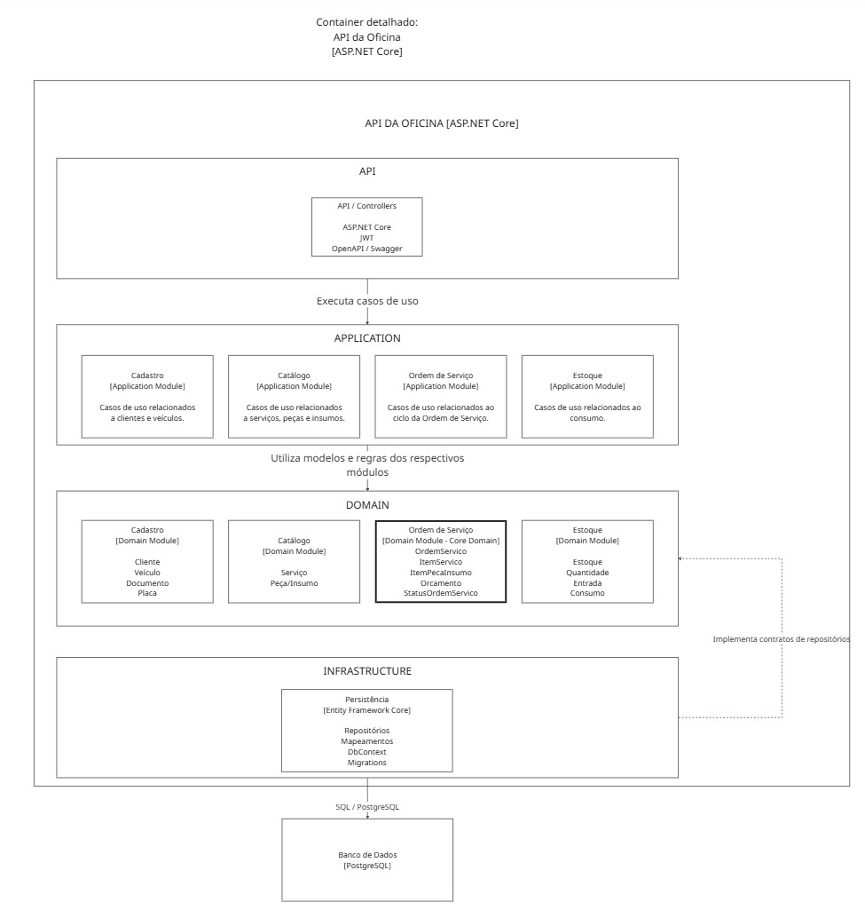

# C4 - Nível 3 - Diagrama de Componentes

## Objetivo

Este diagrama detalha a organização interna do container
API da Oficina, apresentado no diagrama C4 de Nível 2.

O back-end é implementado como um monólito modular utilizando
ASP.NET Core e arquitetura em camadas.

## Organização interna

A aplicação é organizada nas seguintes camadas:

- API;
- Application;
- Domain;
- Infrastructure.

Os Bounded Contexts identificados durante a modelagem DDD são
preservados como módulos internos da aplicação:

- Cadastro;
- Catálogo;
- Ordem de Serviço;
- Estoque.

O módulo de Ordem de Serviço representa o Core Domain.

## API

A camada API representa a interface HTTP da aplicação.

Responsabilidades:

- exposição dos endpoints REST;
- tratamento de requisições e respostas HTTP;
- autenticação e autorização através de JWT;
- documentação das APIs através de OpenAPI/Swagger;
- acionamento dos casos de uso da camada Application.

A camada API não deverá conter regras de negócio pertencentes
ao domínio.

## Application

A camada Application contém os casos de uso da solução.

É responsável pela orquestração das operações necessárias à
execução das funcionalidades do sistema.

A camada é organizada nos módulos:

- Cadastro;
- Catálogo;
- Ordem de Serviço;
- Estoque.

## Domain

A camada Domain concentra o modelo de domínio e suas regras.

Contém:

- Aggregate Roots;
- entidades;
- Value Objects;
- invariantes;
- enums e demais conceitos do negócio;
- contratos dos repositórios dos agregados.

É organizada nos módulos:

### Cadastro

Contém conceitos como Cliente, Veículo, Documento e Placa.

### Catálogo

Contém os conceitos relacionados aos serviços, peças e insumos
disponibilizados pela oficina.

### Ordem de Serviço

Representa o Core Domain da aplicação.

Contém conceitos como OrdemServico, ItemServico,
ItemPecaInsumo, Orcamento e StatusOrdemServico.

### Estoque

Contém as regras relacionadas ao controle da quantidade em estoque,
incluindo entrada e consumo de peças e insumos.

## Infrastructure

A camada Infrastructure contém os detalhes técnicos necessários
à execução da aplicação.

Responsabilidades:

- Entity Framework Core;
- DbContext;
- implementação dos repositórios;
- mapeamentos de persistência;
- migrations;
- acesso ao PostgreSQL.

A Infrastructure implementa os contratos de repositórios definidos
no Domain, permitindo que o domínio permaneça independente das
tecnologias utilizadas para persistência.

## Dependências

As dependências de código deverão preservar a independência
do domínio.

- Domain não depende das demais camadas;
- Application depende de Domain;
- Infrastructure depende de Application e Domain;
- API utiliza Application e Infrastructure.

Durante a execução, os casos de uso da Application utilizam as
implementações fornecidas pela Infrastructure através de contratos,
aplicando o princípio de inversão de dependência.

## Relação com os Bounded Contexts

Os Bounded Contexts não representam aplicações independentes.

Cadastro, Catálogo, Ordem de Serviço e Estoque são implementados
como módulos internos do mesmo monólito e aparecem nas camadas
necessárias conforme suas responsabilidades.

