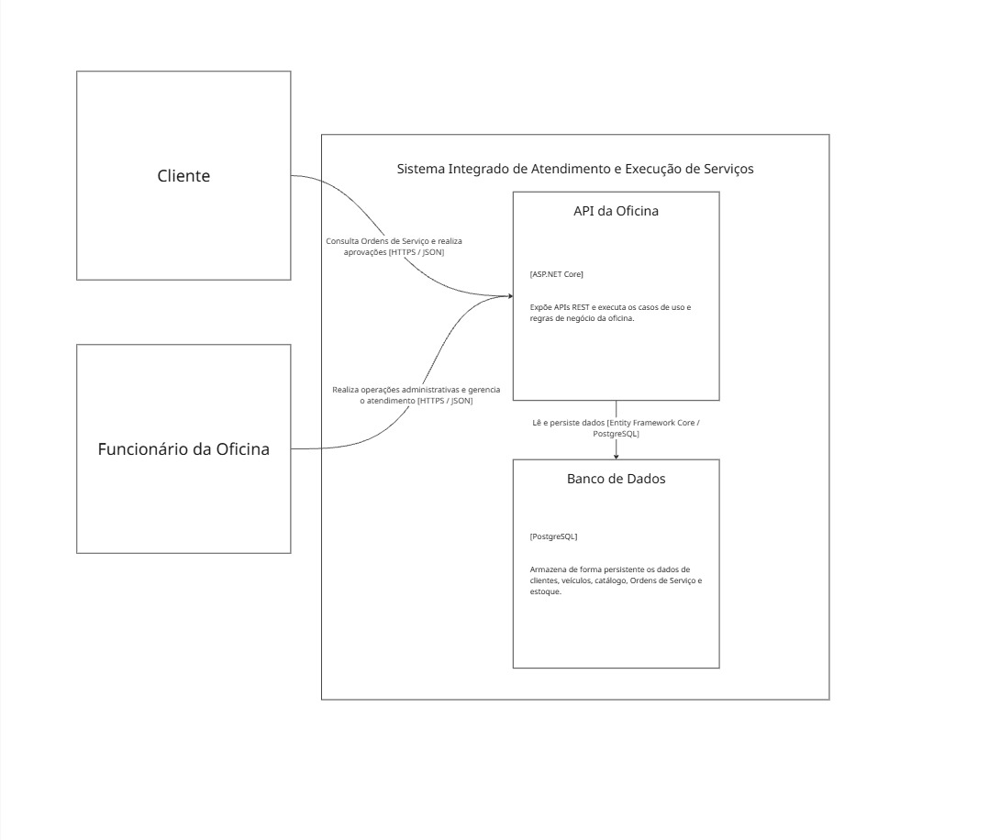

# C4 - Nível 2 - Diagrama de Containers

## Objetivo

O diagrama de containers apresenta as principais unidades executáveis
e de armazenamento que compõem o Sistema Integrado de Atendimento
e Execução de Serviços.

A solução é implementada como um back-end monolítico.

## Containers

### API da Oficina

**Tecnologia:** ASP.NET Core

Back-end monolítico responsável pela exposição das APIs REST e pela
execução dos casos de uso e regras de negócio da oficina.

Entre suas responsabilidades estão:

- disponibilização das APIs REST;
- autenticação e autorização das APIs administrativas;
- documentação das APIs através de OpenAPI;
- execução dos casos de uso;
- aplicação das regras de domínio;
- acesso aos mecanismos de persistência.

Internamente, a aplicação será organizada em módulos alinhados aos
Bounded Contexts identificados durante o DDD.

### Banco de Dados

**Tecnologia:** PostgreSQL

Banco de dados relacional responsável pela persistência das informações
do sistema, incluindo clientes, veículos, catálogo, Ordens de Serviço
e estoque.

O acesso ao banco será realizado pela aplicação através do Entity
Framework Core.

## Pessoas e relacionamentos

### Cliente → API da Oficina

O cliente utiliza as APIs disponibilizadas pelo back-end para consultar
o andamento de suas Ordens de Serviço e realizar as aprovações
permitidas pelo sistema.

**Protocolo:** HTTPS / JSON.

### Funcionário da Oficina → API da Oficina

O funcionário utiliza as APIs administrativas para gerenciar clientes,
veículos, catálogo, estoque e Ordens de Serviço.

As operações administrativas serão protegidas por autenticação.

**Protocolo:** HTTPS / JSON.

### API da Oficina → Banco de Dados

A API realiza operações de leitura e persistência dos dados através
do Entity Framework Core.

## Observação sobre o monólito

Cadastro, Catálogo, Ordem de Serviço e Estoque não representam
containers independentes.

Esses contextos serão implementados como módulos internos do mesmo
back-end monolítico e serão detalhados no diagrama C4 de componentes.

