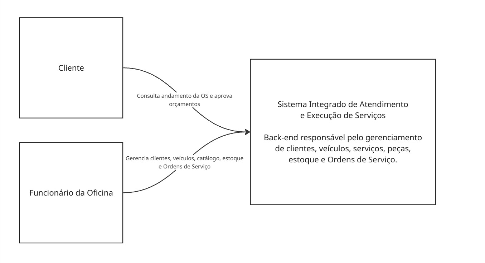

# C4 - Nível 1 - Diagrama de Contexto

## Objetivo

O diagrama de contexto apresenta o Sistema Integrado de Atendimento
e Execução de Serviços e seus principais usuários externos.

## Sistema

### Sistema Integrado de Atendimento e Execução de Serviços

Back-end responsável pelo gerenciamento das operações da oficina,
incluindo clientes, veículos, serviços, peças e insumos, estoque
e Ordens de Serviço.

## Pessoas

### Cliente

Cliente da oficina que utiliza as APIs disponibilizadas pelo sistema
para consultar o andamento de suas Ordens de Serviço e realizar
aprovações relacionadas aos serviços.

### Funcionário da Oficina

Usuário interno responsável pelas operações administrativas e pelo
gerenciamento dos atendimentos realizados pela oficina.

## Relacionamentos

### Cliente → Sistema

O Cliente consulta o andamento de suas Ordens de Serviço e realiza
aprovações através das APIs disponibilizadas pelo sistema.

### Funcionário da Oficina → Sistema

O Funcionário da Oficina utiliza o sistema para gerenciar clientes,
veículos, catálogo, estoque e o ciclo de vida das Ordens de Serviço.

