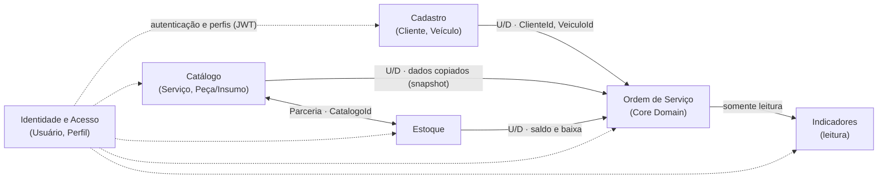

# Context Map

## Objetivo

Este documento descreve os Bounded Contexts identificados durante
a descoberta do domínio, o tipo de subdomínio de cada um e os
relacionamentos existentes entre eles, conforme a implementação
atual do monólito.

## Visão Geral

| Contexto | Tipo de subdomínio | Agregados / conceitos principais |
|---|---|---|
| Ordem de Serviço | **Core Domain** (DD008) | Ordem de Serviço (raiz), Item de Serviço, Item de Peça/Insumo, Orçamento |
| Cadastro | Supporting | Cliente, Veículo, Documento, Placa |
| Catálogo | Supporting | Serviço, Item de Catálogo (Peça/Insumo) |
| Estoque | Supporting | Estoque |
| Identidade e Acesso | Generic | Usuário, Perfil (Administrador, Mecânico) |

O contexto de **Indicadores** (tempo médio de execução, DD013) não é
um Bounded Context próprio: é uma consulta de leitura sobre a
Ordem de Serviço (veja "Indicadores" abaixo).

## Diagrama

`U/D` indica a direção upstream → downstream: o contexto de origem da
seta fornece o que o de destino consome.

## Bounded Contexts

### Cadastro

Responsável pelo gerenciamento de clientes e veículos.

Principais conceitos:

- Cliente;
- Veículo;
- Documento (CPF/CNPJ);
- Placa.

Cliente e Veículo são Aggregate Roots distintos (DD009). O Veículo
referencia o Cliente pelo identificador (`ClienteId`).

### Catálogo

Responsável pelo cadastro das opções comerciais utilizadas pela oficina.

Principais conceitos:

- Serviço;
- Peça;
- Insumo;
- preço;
- situação (ativo/inativo).

Peças e insumos são um único conceito de domínio (`Catalogo`),
diferenciado pelo tipo (DD012). Serviço é um agregado separado.
O Catálogo guarda apenas as informações descritivas e comerciais
do item; a quantidade existente pertence ao Estoque (DD004).

### Ordem de Serviço

Core Domain da aplicação.

Responsável pelo ciclo de atendimento do veículo, incluindo
diagnóstico, composição dos serviços e peças, orçamento, aprovação,
execução, finalização e entrega.

Principais conceitos:

- Ordem de Serviço;
- Item de Serviço;
- Item de Peça/Insumo;
- Orçamento;
- Status da Ordem de Serviço.

A Ordem de Serviço é o Aggregate Root. Item de Serviço, Item de
Peça/Insumo e Orçamento pertencem ao agregado e só são alterados
por meio dele. O ciclo de vida é:

`Recebida → Em Diagnóstico → Aguardando Aprovação → Em Execução → Finalizada → Entregue`

O Orçamento tem estado próprio (Pendente, Aprovado ou Rejeitado) e a
execução só pode ser iniciada com o orçamento aprovado.

### Estoque

Responsável pelo controle quantitativo das peças e insumos.

Principais conceitos:

- quantidade (saldo atual único, DD007);
- entrada;
- consumo (baixa).

Cada registro de Estoque está associado a um item do Catálogo.
Não há reserva de estoque no MVP (DD005): o Estoque mantém somente
o saldo atual.

### Identidade e Acesso

Responsável pelos usuários do sistema e pelo controle de acesso.

Principais conceitos:

- Usuário;
- Perfil (Administrador ou Mecânico);
- autenticação por JWT.

É um subdomínio genérico, que não carrega regras do negócio da oficina.
Os perfis determinam quais operações cada usuário pode executar nos
demais contextos. Por exemplo, a criação da Ordem de Serviço e a
entrega do veículo são restritas ao Administrador, enquanto o
diagnóstico, o orçamento e o registro de consumo também podem ser
feitos pelo Mecânico.

### Indicadores

Não é um Bounded Context próprio. É uma consulta de leitura que
calcula o tempo médio de execução a partir das Ordens de Serviço
Finalizadas ou Entregues (DD013), sem alterar nenhum agregado.
O acesso é restrito ao Administrador.

## Relacionamentos

### Cadastro → Ordem de Serviço

**Cadastro é upstream.** A Ordem de Serviço utiliza apenas as
identidades de Cliente e Veículo (`ClienteId`, `VeiculoId`),
sem conter os agregados completos (DD002, DD003).

Na criação da OS, o cliente é localizado pelo documento e o veículo
pela placa. A OS só é criada se o veículo pertencer ao cliente.
Esse é o ponto em que o contexto de Ordem de Serviço depende
da consulta ao Cadastro.

### Catálogo → Ordem de Serviço

**Catálogo é upstream.** A OS consulta serviços, peças e insumos
disponíveis no Catálogo e registra no item da OS os dados comerciais
aplicáveis no momento da inclusão: identificador de origem, descrição
ou nome, tipo e preço (DD001, DD010).

Alterações posteriores no Catálogo não alteram Ordens de Serviço
existentes. Itens inativos não podem ser adicionados à OS.

### Estoque → Ordem de Serviço

**Estoque é upstream** quanto às regras de saldo.

- Ao incluir uma peça ou insumo na OS, o saldo do Estoque é consultado
  (considerando o que a OS já incluiu e ainda não consumiu), mas
  **o Estoque não é alterado** (DD005, DD006).
- Ao registrar o consumo durante a execução, a OS marca os itens como
  consumidos e o saldo do Estoque é reduzido. O consumo não pode ser
  superior ao saldo atual (DD007).

No código, essa coordenação é feita pelo serviço de aplicação da
Ordem de Serviço (`OrdemServicoService`), que consulta o Estoque e
aplica a baixa na mesma operação. A regra de validação e de alteração
da quantidade permanece na entidade `Estoque` (DD011).

### Catálogo ↔ Estoque

**Parceria.** O Estoque referencia o item do Catálogo por `CatalogoId`
(DD004). Um registro de Estoque só pode ser criado para um item
de Catálogo existente.

### Identidade e Acesso → demais contextos

O contexto de Identidade e Acesso emite o token JWT e define os perfis.
Os demais contextos apenas **conformam-se** a ele, por meio de regras
de autorização nos endpoints da API, sem depender de seu modelo interno.

As operações de aprovação e rejeição do orçamento são feitas pelo
próprio cliente, identificado por CPF/CNPJ (e pela placa, quando houver
mais de uma OS aguardando decisão), e não exigem autenticação.
A consulta das Ordens de Serviço por documento também é pública.

## Observações sobre a implementação

- Os Bounded Contexts são limites **lógicos** dentro de um monólito
  modular em camadas (ADR-001). Compartilham o mesmo banco de dados
  e o mesmo `DbContext`; a separação é conceitual, por agregados e
  serviços, e não por projetos ou esquemas.
- Não há mensageria nem eventos de domínio entre os contextos.
  A integração é síncrona, dentro da mesma transação.
- Entre agregados, os relacionamentos são feitos por identificador
  (DD009). A exceção é a navegação do Estoque para o item de Catálogo.
