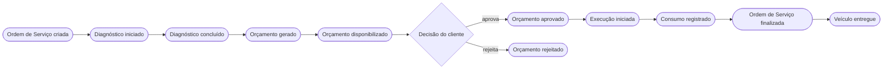
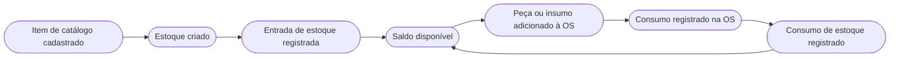

# Event Storming

## Objetivo

O Event Storming foi utilizado para explorar os principais fluxos do
domínio da oficina mecânica, identificar eventos de domínio, comandos,
atores, políticas, regras de negócio, agregados candidatos e pontos que
necessitavam de maior investigação.

Foram modelados os fluxos relacionados à Ordem de Serviço e à gestão
de peças, insumos e estoque.

A versão visual dos Event Stormings encontra-se no arquivo:

- [Event Storming](event-storming.pdf)

## Atores

Os atores identificados nos fluxos são:

- **Cliente**: pessoa física ou jurídica que solicita o serviço e decide
  sobre o orçamento. Identificado por CPF ou CNPJ e sem necessidade de
  autenticação para aprovar ou rejeitar o orçamento;
- **Administrador**: atende o cliente, cria e acompanha a Ordem de
  Serviço, administra cadastros, catálogo e estoque e realiza a entrega
  do veículo;
- **Mecânico**: conduz o diagnóstico, gera e disponibiliza o orçamento,
  registra o consumo de peças e insumos e finaliza a execução.

## Event Storming - Ordem de Serviço

O fluxo de Ordem de Serviço contempla a criação e o acompanhamento
da Ordem de Serviço durante seu ciclo de vida.

Entre os principais elementos identificados estão:

- identificação do cliente;
- identificação do veículo;
- criação da Ordem de Serviço;
- registro dos serviços solicitados;
- início e conclusão do diagnóstico;
- identificação e registro das peças e insumos necessários;
- geração automática do orçamento;
- disponibilização do orçamento ao cliente;
- aprovação ou rejeição do orçamento;
- início da execução após aprovação;
- registro do consumo de peças e insumos;
- conclusão dos serviços;
- finalização da Ordem de Serviço;
- entrega do veículo.

Os estados da Ordem de Serviço considerados durante o processo são:

- Recebida;
- Em diagnóstico;
- Aguardando aprovação;
- Em execução;
- Finalizada;
- Entregue.

As alterações de status são consequências das ações realizadas
durante o ciclo da Ordem de Serviço.

### Linha do tempo: comandos, eventos e atores

O quadro abaixo detalha o fluxo da Ordem de Serviço em ordem
cronológica, relacionando cada comando ao seu ator, ao evento de
domínio gerado e ao estado resultante.

| # | Ator | Comando | Evento de domínio | Estado da Ordem de Serviço |
|---|---|---|---|---|
| 1 | Administrador | Criar Ordem de Serviço (CPF/CNPJ do cliente e placa do veículo) | Ordem de Serviço criada | Recebida |
| 2 | Administrador | Adicionar serviço | Serviço adicionado | Recebida ou Em diagnóstico |
| 3 | Administrador ou Mecânico | Iniciar diagnóstico | Diagnóstico iniciado | Em diagnóstico |
| 4 | Administrador | Adicionar peça ou insumo | Peça ou insumo adicionado | Em diagnóstico |
| 5 | Administrador ou Mecânico | Concluir diagnóstico | Diagnóstico concluído | Em diagnóstico |
| 6 | Administrador ou Mecânico | Gerar orçamento | Orçamento gerado (pendente) | Em diagnóstico |
| 7 | Administrador ou Mecânico | Disponibilizar orçamento | Orçamento disponibilizado | Aguardando aprovação |
| 8a | Cliente | Aprovar orçamento | Orçamento aprovado | Aguardando aprovação |
| 8b | Cliente | Rejeitar orçamento | Orçamento rejeitado | Aguardando aprovação |
| 9 | Administrador | Iniciar execução | Execução iniciada | Em execução |
| 10 | Administrador ou Mecânico | Registrar consumo de peças e insumos | Consumo registrado | Em execução |
| 11 | Administrador ou Mecânico | Finalizar Ordem de Serviço | Ordem de Serviço finalizada | Finalizada |
| 12 | Administrador | Entregar veículo | Veículo entregue | Entregue |

Observações sobre o quadro:

- a **conclusão do diagnóstico** é um evento próprio e não altera o
  estado da Ordem de Serviço; ela é pré-condição para a geração do
  orçamento;
- a **aprovação ou rejeição** altera o estado do Orçamento
  (pendente, aprovado ou rejeitado), e não o estado da Ordem de Serviço;
- a **execução** só pode ser iniciada com o orçamento aprovado.

### Visão do fluxo

### Aprovação do orçamento

Após a disponibilização do orçamento, o cliente poderá aprová-lo
ou rejeitá-lo.

A aprovação permite o início da execução da Ordem de Serviço,
mas não inicia a execução automaticamente.

A rejeição não autoriza o início da execução.

O cliente decide informando seu CPF ou CNPJ. Quando possuir mais de uma
Ordem de Serviço aguardando decisão, deverá também informar a placa
do veículo para que a Ordem de Serviço correta seja identificada.

### Políticas e regras do fluxo

As políticas abaixo descrevem as reações e restrições identificadas
durante o Event Storming:

- **Quando** um serviço ou item de catálogo é adicionado à Ordem de
  Serviço, **então** seu nome e preço vigentes são registrados no item
  da Ordem de Serviço (DD001, DD010);
- **Quando** o item de catálogo ou o serviço está inativo, **então**
  ele não pode ser adicionado à Ordem de Serviço;
- **Quando** uma peça ou insumo é adicionado, **então** o saldo do
  estoque é verificado, considerando o que já foi incluído na Ordem de
  Serviço e ainda não consumido, mas nada é reservado (RN007);
- **Quando** o orçamento é gerado, **então** o valor total é calculado
  a partir dos serviços e das peças e insumos da Ordem de Serviço
  (RN004), e novos serviços ou peças e insumos não podem mais ser
  adicionados;
- **Quando** o diagnóstico ainda não foi concluído ou a Ordem de
  Serviço não possui ao menos um serviço, **então** o orçamento não
  pode ser gerado;
- **Quando** o orçamento é aprovado, **então** a execução pode ser
  iniciada, mas não é iniciada automaticamente (RN005);
- **Quando** o consumo é registrado, **então** a quantidade do Estoque
  é reduzida (RN009). O registro é tudo ou nada: se algum item for
  inválido, já consumido ou sem saldo, nenhum consumo é efetivado.

### Comandos recusados

Alguns comandos podem ser recusados pelo domínio. Os principais casos
são:

| Comando | Motivo da recusa |
|---|---|
| Criar Ordem de Serviço | Cliente ou veículo não encontrado, ou veículo que não pertence ao cliente |
| Adicionar serviço | Estado da Ordem de Serviço não permite, ou orçamento já gerado |
| Adicionar peça ou insumo | Ordem de Serviço fora de diagnóstico, orçamento já gerado ou estoque insuficiente |
| Gerar orçamento | Diagnóstico não concluído, orçamento já existente ou nenhum serviço informado |
| Aprovar ou rejeitar orçamento | Orçamento já decidido, ou nenhuma Ordem de Serviço aguardando decisão do cliente |
| Iniciar execução | Orçamento não aprovado |
| Registrar consumo | Ordem de Serviço fora de execução, item já consumido ou estoque insuficiente |

### Pontos de atenção

Durante o Event Storming foram identificadas questões que ainda não
possuem definição explícita nos requisitos do MVP.

Permanecem como pontos de atenção:

- definir o comportamento da Ordem de Serviço após a rejeição
  de um orçamento;
- definir se um orçamento já disponibilizado ao cliente poderá
  ser alterado.

Esses pontos não impedem a implementação dos requisitos obrigatórios
da primeira versão do sistema e poderão ser refinados conforme
necessidade do domínio.

Situação na implementação atual:

- após a **rejeição** do orçamento, a Ordem de Serviço permanece em
  Aguardando aprovação, sem execução e sem estado de encerramento ou
  cancelamento. O comportamento definitivo continua em aberto;
- após a **geração** do orçamento não é possível adicionar serviços nem
  peças e insumos, e não há geração de um novo orçamento. A alteração
  de um orçamento já disponibilizado também continua em aberto.

## Event Storming - Gestão de Peças, Insumos e Estoque

O segundo fluxo modelado representa as operações necessárias para
o controle simplificado do estoque da oficina.

O MVP trabalhará com uma única quantidade representando o saldo
atual de cada peça ou insumo.

Não será utilizado mecanismo de reserva de estoque.

O fluxo contempla:

- cadastro de peça ou insumo;
- registro de entrada de estoque;
- atualização da quantidade em estoque;
- registro de consumo durante a execução da Ordem de Serviço;
- atualização da quantidade após o consumo.

O consumo somente poderá ser registrado quando existir quantidade
suficiente em estoque.

A simples inclusão de uma peça ou insumo na Ordem de Serviço ou
no orçamento não altera a quantidade existente em estoque.

### Linha do tempo: comandos, eventos e atores

| # | Ator | Comando | Evento de domínio | Regra |
|---|---|---|---|---|
| 1 | Administrador | Cadastrar peça ou insumo no Catálogo | Item de catálogo cadastrado | Nome obrigatório e preço não negativo |
| 2 | Administrador | Criar estoque do item | Estoque criado | O item de catálogo deve existir; quantidade inicial não negativa |
| 3 | Administrador | Registrar entrada | Entrada de estoque registrada | Quantidade maior que zero |
| 4 | Administrador ou Mecânico | Atualizar quantidade | Quantidade de estoque ajustada | Quantidade não negativa (RN010) |
| 5 | Administrador ou Mecânico | Registrar baixa | Consumo de estoque registrado | Quantidade maior que zero e não superior ao saldo (RN008) |
| 6 | Administrador ou Mecânico | Registrar consumo na Ordem de Serviço | Consumo registrado e estoque reduzido | Ordem de Serviço em execução; veja o fluxo abaixo |

### Visão do fluxo

Existem duas formas de reduzir o estoque: a baixa direta, feita sobre o
próprio registro de estoque, e o consumo registrado a partir de uma
Ordem de Serviço em execução.

## Relação entre os fluxos

Os Event Stormings de Ordem de Serviço e Estoque se relacionam
durante a execução da Ordem de Serviço.

Quando uma peça ou insumo é efetivamente utilizado, a Ordem de Serviço
registra o consumo e o contexto de Estoque é responsável por validar
e atualizar a quantidade existente.

Essa separação preserva as responsabilidades identificadas nos
Bounded Contexts de Ordem de Serviço e Estoque.

Na implementação atual, a ligação entre os dois fluxos é feita de forma
síncrona, na mesma operação:

1. a Ordem de Serviço marca as peças e insumos informados como
   consumidos;
2. para cada item, o Estoque correspondente é localizado e o saldo é
   verificado;
3. a quantidade é reduzida pelo Estoque;
4. as alterações são gravadas em conjunto. Se um item não tiver estoque
   cadastrado ou saldo suficiente, a operação é recusada e nenhuma
   alteração é efetivada.

Não há eventos publicados entre os contextos. Os eventos descritos neste
documento são eventos de domínio de modelagem.

## Artefatos relacionados

- [Linguagem Ubíqua](linguagem-ubiqua.md)
- [Regras de Negócio](regras-negocio.md)
- [Decisões de Domínio](decisoes-dominio.md)
- [Context Map](context-map.md)
- [Diagramas DDD](diagramas.pdf)